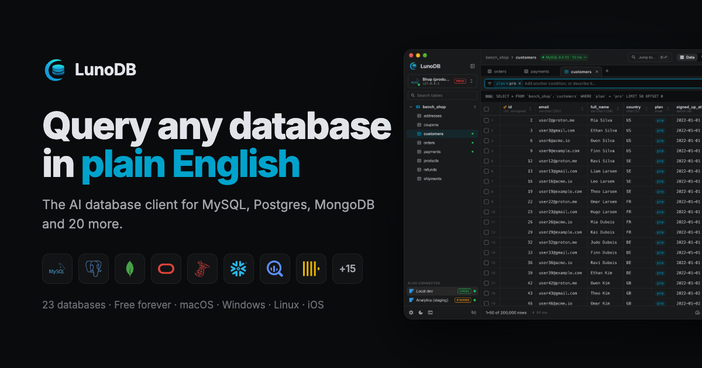
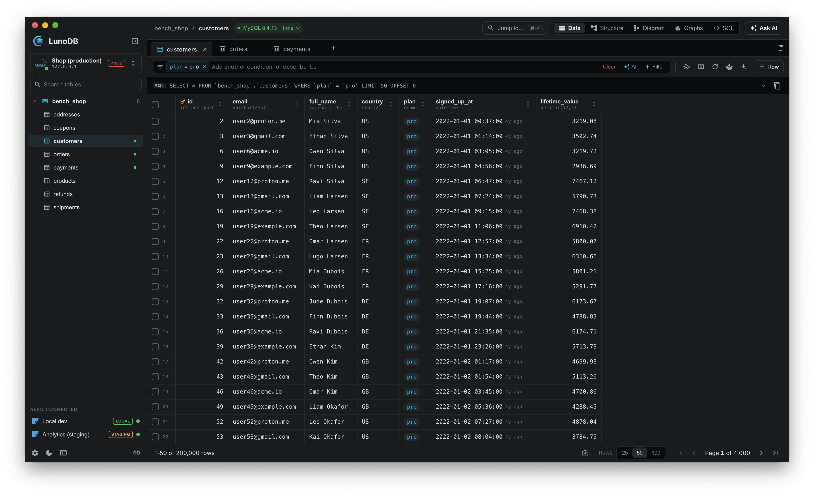
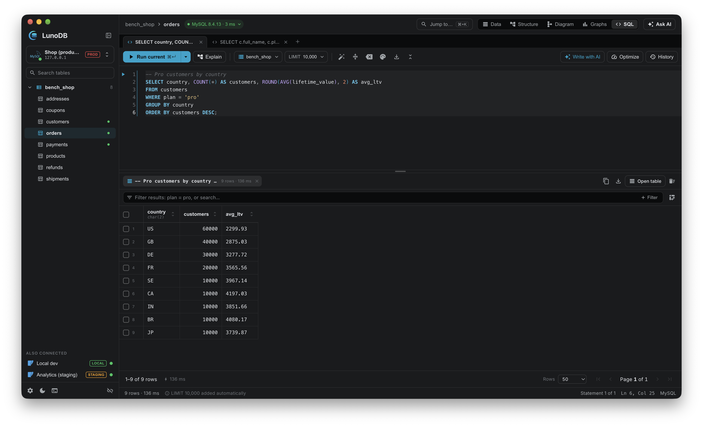
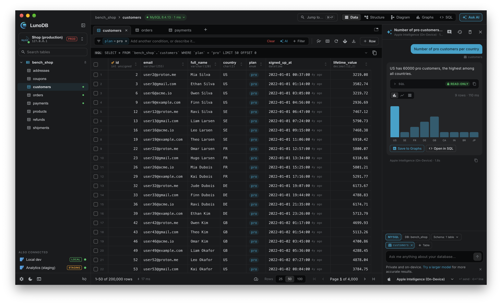

<p align="center">
  
</p>

# LunoDB


A fast, cross-platform desktop client for 23 kinds of database, with a built-in AI assistant that answers questions straight from your data.

**[Download the latest release](https://github.com/lunodb/lunodb/releases/latest)** · [Docs](https://lunodb.app/docs) · [LunoDB Mobile](#lunodb-mobile)

## What's New in 2.10

- Select cells to see their sum, average, min and max, and transpose wide rows
- Compare query results and database schemas, search every table at once, and tunnel through SSH jump hosts (Pro)
- **Pro Lifetime:** $25 once, on every computer you own, with every update forever. Earlier one-time licenses are upgraded for free
- Socket-file connections on MySQL, MariaDB and PostgreSQL

See the [release notes](https://github.com/lunodb/lunodb/releases) for every version.

## Download

| Platform | Builds | Updates |
|----------|--------|---------|
| macOS 12+ | Apple Silicon (`arm64.dmg`) or Intel (`x64.dmg`) | Automatic |
| Windows 10+ | x64 | Automatic |
| Linux (Ubuntu 20.04+ / RHEL 8+) | AppImage (recommended), DEB, RPM, for x64 and ARM64 | AppImage automatic · DEB asks for your password · RPM manual |

**Homebrew (macOS):**

```sh
brew install --cask idevtim/tap/lunodb
```

LunoDB updates itself after installing, so `brew upgrade` leaves it alone unless you pass `--greedy`.

### Upgrade Notes

- **From 1.x:** saved passwords move into your system keychain. If you might go back to 1.x, make a backup in **Settings → Backup** first.
- **PostgreSQL with SSL set to Prefer:** LunoDB no longer sends your password unencrypted to a server that refuses SSL. If your remote server really has no SSL, set its SSL mode to **Disable**.
- **Backups made with 2.8.1 or later** need LunoDB 2.8+ or LunoDB Mobile 2.1.1+ to open.

## Supported Databases

MySQL · MariaDB · PostgreSQL · SQLite · SQL Server · Oracle · MongoDB · Redis · Turso · ClickHouse · DuckDB · Cassandra · Elasticsearch · Cloud Firestore · Firebase Realtime Database · BigQuery · Snowflake

Plus dedicated entries for Supabase, Neon, CockroachDB, Amazon Redshift, Valkey and OpenSearch.

## Features

- **Connections** - Paste a connection URL, use SSH tunnels and SSL/TLS, group connections in folders, and see every database on a server from one connection
- **Data grid** - Fast paging through millions of rows, filters in plain words, safe editing that shows the SQL before saving, and exports to CSV, JSON, SQL and Excel
- **SQL editor** - Schema-aware suggestions, run one statement or the whole script, query history, saved queries and Explain plans
- **Structure & graphs** - Edit tables, view relationship diagrams, and build charts from your own SQL
- **AI assistant** - Ask a question and get an answer from a read-only query. Works with OpenAI, Anthropic, Google, Grok, DeepSeek, OpenRouter, or fully on-device with Ollama and Apple Intelligence
- **MCP server** - Let Claude Code, Cursor and other AI agents read the connections you share, read-only (Pro)
- **Safety** - Safe mode for production, passwords stored in your system keychain, and saves that run in a single transaction

## Screenshots





## Pricing

LunoDB is **free** for personal and commercial use, with no time limit. Try Pro free for 14 days, no credit card needed.

**Pro Lifetime: $25 once.** No subscription, use it on every computer you own, and get every future update. Have a monthly subscription? Manage it at [lunodb.app/account](https://lunodb.app/account).

| Feature | Free | Pro |
|---------|------|-----|
| Database connections | Up to 2 | Unlimited |
| Basic query editor, CSV export, SSL/TLS | ✓ | ✓ |
| AI features (SQL generation, AI filters, chat) | ✓ | ✓ |
| Schema-aware SQL editor | ✗ | ✓ |
| JSON & SQL export | ✗ | ✓ |
| SQL history & query log | Limited | Unlimited |
| Graphs, AI answer cards, SSH tunnels | ✗ | ✓ |
| Priority support | ✗ | ✓ |

**[Get LunoDB Pro](https://lunodb.app/purchase)**

## LunoDB Mobile

Free on [iOS](https://apps.apple.com/us/app/lunodb/id6756377885) for iPhone and iPad (Android coming soon). Connect to MySQL, PostgreSQL, MariaDB, MongoDB, SQLite and Turso, and move your connections and graphs over from the desktop app with a QR code. [Learn more](https://lunodb.app/mobile)

## Support

- **Docs:** [lunodb.app/docs](https://lunodb.app/docs)
- **Bugs & feature requests:** [GitHub Issues](https://github.com/lunodb/lunodb/issues)
- **Email:** support@lunodb.app
- **Follow:** [X](https://x.com/lunodb_app) · [LinkedIn](https://www.linkedin.com/company/lunodb)

---

**© 2025-2026 LunoDB** • Made with ❤️ for developers
