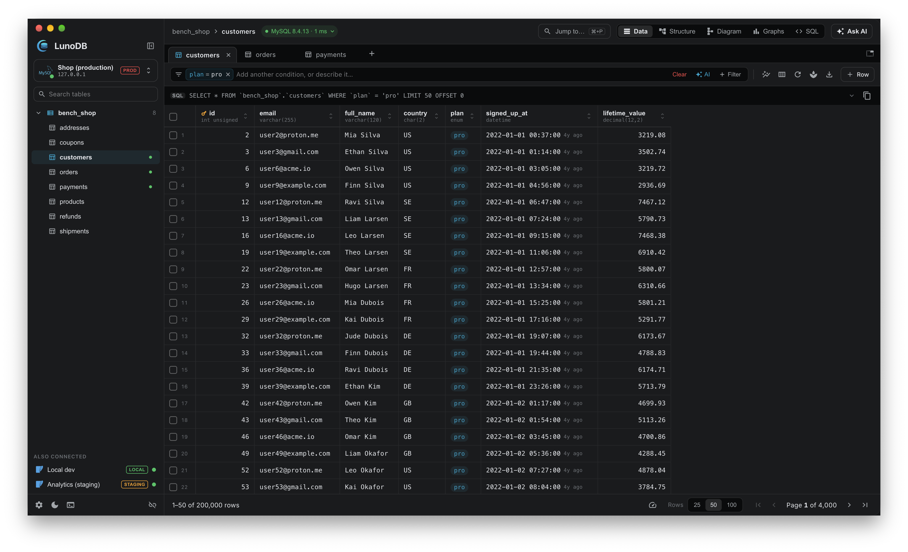
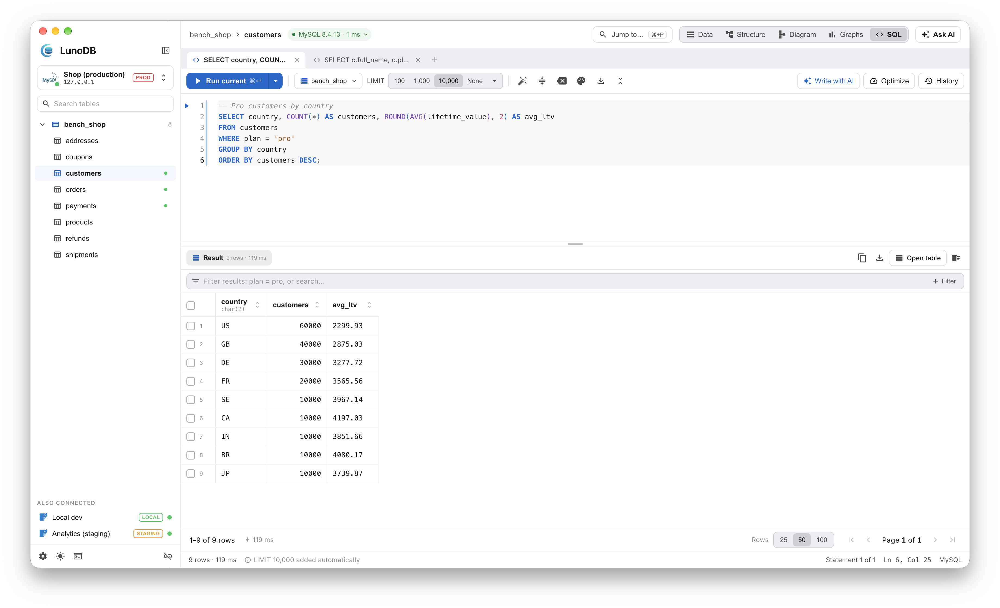
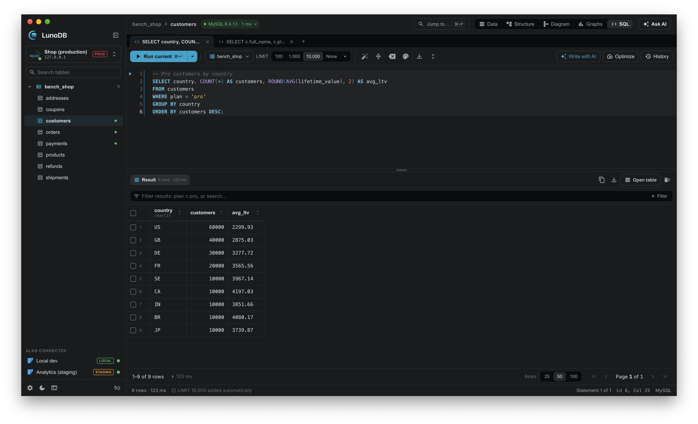
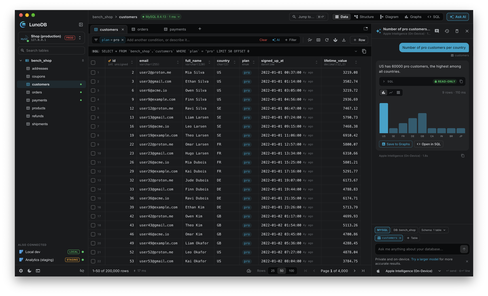

  

# LunoDB

LunoDB is a professional-grade, cross-platform database management client designed for developers and database administrators. Built with modern technologies, it provides comprehensive tools for managing multiple databases with an intuitive, native desktop experience.

**✨ NEW in v2.0:** A ground-up redesign built for speed and simplicity — a new connections home, workspace, data grid, SQL editor, Structure and Graphs views, and an AI assistant that answers questions straight from your data. It starts faster, takes about 40% less disk space on a Mac, and keeps every feature you already rely on. [Full release notes](https://github.com/lunodb/lunodb/releases/tag/v2.0.0)

**v2.1.0:** Switching between table tabs is close to instant, and MySQL and MariaDB exports are faster, with files that import faster and come back exactly as they went out. Apple Intelligence now fits much bigger schemas. [Release notes](https://github.com/lunodb/lunodb/releases/tag/v2.1.0)

> **⚠️ Upgrading from 1.x:** 2.0 moves saved passwords into your system keychain (converted automatically on first launch). If you later go back to a 1.x version, you'll need to re-enter those passwords — make a backup in **Settings → Backup** first if you might.

**LunoDB Mobile is here!** - Manage your databases on the go. Available now on [iOS](https://apps.apple.com/us/app/lunodb/id6756377885), Android coming soon. [Learn more](#lunodb-mobile)

## Download

[**Download Latest Release**](https://github.com/lunodb/lunodb/releases/latest)

- **macOS** - Separate builds for Apple Silicon and Intel (fully automatic updates)
  - **Apple Silicon** (M1 and later, recommended) - `LunoDB-<version>-arm64.dmg`
  - **Intel** - `LunoDB-<version>-x64.dmg`
- **Windows** - x64 (fully automatic updates)
- **Linux**:
  - **AppImage** - Fully automatic updates (recommended)
  - **DEB Package** - Semi-automatic updates (requires password)
  - **RPM Package** - Manual updates via GitHub

## Auto-Updates

LunoDB includes built-in update notifications with varying levels of automation by platform:

- **macOS & Windows** - Fully automatic: downloads and installs updates seamlessly in the background
- **Linux AppImage** - Fully automatic: installs updates without requiring passwords or system permissions
- **Linux DEB** - Semi-automatic: downloads updates automatically, but requires your password to install (via system authentication)
- **Linux RPM** - Manual: notifies you of new versions and directs you to download from GitHub releases

All versions include in-app release notes and update notifications to keep you informed of new features and improvements.

## Supported Databases

🐬 **MySQL** - MySQL 5.7+, 8.0+
🦭 **MariaDB** - MariaDB 10.0+
🐘 **PostgreSQL** - PostgreSQL 10+
📄 **SQLite** - SQLite 3.x
🏢 **SQL Server** - SQL Server 2016+, Azure SQL
🍃 **MongoDB** - MongoDB 4.0+, Atlas
🔴 **Redis** - Redis 6.0+, Redis Cloud
🪶 **Turso** - LibSQL databases with full support

## Features

### Connections
- **Multi-Database Support** - MySQL, PostgreSQL, SQLite, MariaDB, MongoDB, SQL Server, Redis, and Turso
- **Connections Home** - Every saved connection in one place, with search across names, hosts, databases and tags, environment filters (Production, Staging, Local) and drag-to-reorder
- **Paste a Connection URL** - `postgres://`, `mysql://`, `mongodb://`, `redis://`, `libsql://` and more fill in the form for you; test before saving
- **Pick Up Where You Left Off** - Reconnects last session's connections side by side; open the workspace as soon as one is ready
- **SSH Tunneling** - Password, key file, or SSH agent (including 1Password and Secretive); encrypted keys ask for their passphrase once
- **SQLite Files** - Drop a file on the window to open it, see recent files, or **Open read-only** to browse safely
- **Turso Local Replicas** - Work from a local copy that syncs each time you connect
- **Resilient Reconnection** - A non-blocking banner, five retries with backoff, pauses while offline, and cached rows stay on screen read-only while a connection is down
- **Multiple Workspaces** - Independent windows, each remembering its own connections and tabs

### Data View
- **Fast, Clear Grid** - Column types and key icons in headers, right-aligned numbers, highlighted `NULL`s, tags for booleans and enums, relative dates
- **Safe Editing** - Edited cells stay highlighted, **Review** shows the exact SQL before **Save**, and saves run in one transaction — all or nothing. Production connections ask first
- **One Filter Bar** - Type `plan = pro` or `total >= 100`, or describe the filter in plain words and let AI build it; filters show as editable chips
- **Instant Deep Paging** - The last page of a 10 million row MySQL table opens in milliseconds
- **Column Stats** - Right-click a header for min, max, average, NULLs and distinct values
- **Flexible Export** - Filtered rows, the current page, selected rows or the whole table as CSV, JSON or SQL INSERT, with column picking, preview and size estimate; big exports keep running in the corner
- **Seed Fake Data** - Realistic sample rows matched to column types and names, respecting keys and constraints
- **Copy & Paste Rows** - Duplicate data between tables with ⌘C/Ctrl+C and ⌘V/Ctrl+V (Pro)

### SQL Editor
- **Schema-Aware Editor** - Suggestions for your tables (with row counts) and columns (with types), hover info, and failed lines marked with the database's error
- **Run Current or Run All** - Click ▶ beside any statement to run just that one; **Run all** keeps your whole script on one connection so transactions, `SET` and temp tables hold together
- **Safer Scripts** - Run all stops at the first failure and rolls back, asks to commit or roll back an open transaction, and can run the whole script as one transaction
- **Results Like the Data View** - One tab per statement plus a **Messages** tab; edit results, even from joins, on MySQL, MariaDB, PostgreSQL and SQLite
- **History Panel** - Search past queries, star the ones you reuse, and add notes
- **Query Log** - Every query with execution time, status and errors, in a drawer along the bottom (Pro)
- **Import & Export** - CSV, JSON and SQL with Gzip compression, drag-and-drop imports, and cancellable, minimizable jobs

### Structure & Graphs
- **Structure View** - Row counts, sizes, colour-coded types and key tags; edit columns in place and add columns and indexes with the exact SQL shown first
- **Schema Diagrams** - Interactive foreign key relationship diagrams, exportable as images
- **Graphs** - Bar, line, area, pie and scatter charts from your own SQL, with a live preview, the rows shown under the chart, and PNG export (Pro)
- **AI Graph Suggestions** - Let AI propose charts for your data

### AI Assistant
- **Answers, Not Just SQL** - Ask a question and the assistant runs a read-only query for you and shows the result as a one-line answer, a chart, a number or a table — then **Save to Graphs**, **Open in SQL** or **Apply as filter** (Pro)
- **Safe by Design** - Answers run only a single SELECT inside a read-only transaction, capped at 10 seconds and 1,000 rows. Queries that change data are shown for review, never run for you
- **Write with AI, Optimize, Insights** - Generate and refine SQL with version history, get index-aware optimization with before/after scores, and data quality insights for any table
- **9 AI Providers** - OpenAI (GPT-6.1 Sol, GPT-6 Astra, Sol & Luna), Anthropic (Claude Opus 5.5, Sonnet 5.5, Haiku 5.5), Google (Gemini 3.8, 3.7 & 3.6 Flash), Grok 4.7, 4.6 & 4.5, DeepSeek, OpenRouter, Ollama, Apple Intelligence (on-device), Custom
- **Fully Private Options** - Apple Intelligence and Ollama run on your machine with no external requests and no API key
- **You Choose What It Sees** - Pick which tables the AI knows about and see exactly what it's told. Cloud providers receive your request and schema, plus the rows a feature needs (for example, up to 50 rows of an answer for its summary); turn automatic answers off in **Settings → AI → Features**

### Everywhere
- **Jump To** - ⌘P / Ctrl+P lists your tables, then actions
- **Polished Interface** - Light and dark themes, dialogs that always fit the window, LunoDB-styled right-click menus, and subtle sounds (can be disabled)
- **Calmer Crash Screen** - Plain-language errors with **Reload** or **Reload without tabs**, and a reference to quote to support
- **Transfer to Mobile** - QR code sync to transfer connections and graphs to LunoDB Mobile

### Performance & Security
- **Faster Startup, Smaller App** - Heavy views load the first time you open them; about 280 MB installed on a Mac, down from about 470 MB
- **Keychain-Encrypted Credentials** - Saved passwords, tokens and passphrases are encrypted with macOS Keychain, Windows Credential Manager or the Linux secret service
- **Keys Stay in the Background** - Saved passwords and AI API keys never reach the app window
- **SSL/TLS Support** - Encrypted database connections

## Screenshots

### Home Screen

### Query Editor - Light Theme

### Query Editor - Dark Theme

### AI Features

## System Requirements

| Platform | Minimum Version |
|----------|----------------|
| macOS | 12 (Monterey) or later |
| Windows | Windows 10 or later |
| Linux | Ubuntu 20.04+ / RHEL 8+ |

## Pricing

LunoDB is **free to use** with no time restrictions for personal and commercial use.

**🎁 14-Day Pro Trial** - Try all Pro features free for 14 days with a simple email signup. No credit card required.

### Plans

| Plan | One-Time | Monthly |
|------|----------|---------|
| **Pro** (1 device) | $10 | $1.99/month |
| **Pro Bundle** (up to 3 devices) | $20 (was $30) | $3.99/month (was $5.97) |

Pay once, or subscribe monthly and cancel anytime.

- **One-time licenses** never expire and include 1 year of updates. After that, Pro keeps working with every feature; you just stop getting new versions. [Renew anytime](https://lunodb.app/license/renew) for another year of updates on the same license key ($10 for Pro, $20 for the Pro Bundle).
- **Monthly subscriptions** include every update for as long as you stay subscribed.

### Feature Comparison

| Feature | Free | Pro |
|---------|------|-----|
| Database Connections | Up to 2 | Unlimited |
| Schema-Aware SQL Editor | ✗ | ✓ |
| Export to CSV | ✓ | ✓ |
| Export to JSON & SQL | ✗ | ✓ |
| SQL History & Query Log | Limited | Unlimited |
| Graphs & Visualizations | ✗ | ✓ |
| AI Features (SQL generation, AI filters, chat) | ✓ | ✓ |
| AI Answer Cards (answers run on your data) | ✗ | ✓ |
| SSH Tunnels | ✗ | ✓ |
| SSL/TLS Connections | ✗ | ✓ |
| Basic Query Editor | ✓ | ✓ |
| Priority Support | ✗ | ✓ |
| Commercial Use | ✓ | ✓ |

We encourage users who find LunoDB helpful to consider going Pro to support ongoing development and help us build more features.

**[Get LunoDB Pro](https://lunodb.app/purchase)**

## LunoDB Mobile

Take your database management on the go with LunoDB Mobile. **Available now on iOS, completely free.**

Android support is coming soon.

### Features
- **5 Database Types** - MySQL, PostgreSQL, MariaDB, SQLite, and Turso
- **Direct Connections** - Turso connects directly via HTTPS, SQLite works locally - no proxy needed
- **SQLite File Import** - Import existing .db, .sqlite, and .sqlite3 files from your device or cloud storage
- **QR Code Sync** - Instantly transfer all connections, graphs, and SSH tunnels from LunoDB Desktop
- **Query Editor** - Write and execute queries with mobile-optimized interface
- **AI Assistant** - Natural language SQL generation with your own API keys
- **Visualizations** - Charts, graphs, and ER diagrams on the go
- **Secure Connections** - MySQL, PostgreSQL, and MariaDB connect via LunoDB Cloud proxy
- **Biometric Security** - Face ID and fingerprint lock for your connections

### Connection Types

| Database | Connection Method |
|----------|------------------|
| MySQL, PostgreSQL, MariaDB | Via LunoDB Cloud (secure proxy) |
| Turso | Direct HTTPS (no proxy) |
| SQLite | Local files on device |

Learn more on our [website](https://lunodb.app/mobile) or follow us on [X](https://x.com/lunodb_app) for updates.

## Documentation & Support

- **Documentation** - [GitHub Wiki](https://github.com/lunodb/lunodb/wiki)
- **Bug Reports** - [GitHub Issues](https://github.com/lunodb/lunodb/issues)
- **Feature Requests** - [GitHub Discussions](https://github.com/lunodb/lunodb/discussions)

## Contact

**Email:** support@lunodb.app
**Website:** https://lunodb.app
**X:** [@lunodb_app](https://x.com/lunodb_app)
**LinkedIn:** [LunoDB](https://www.linkedin.com/company/lunodb)

---

**© 2025-2026 LunoDB** • Made with ❤️ for developers
